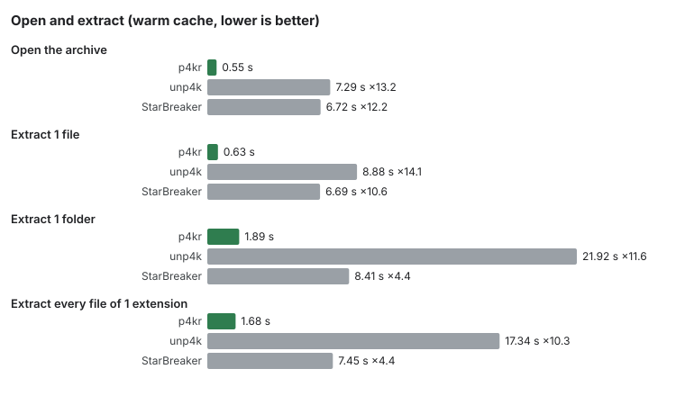

# p4kr

[English](README.md) | Français

Lecteur natif d'archives `.p4k` en Rust : ZIP64 avec blocs extra propres au format, AES-128-CBC, zstd, contrôles CRC32C et sha256. Il liste, extrait et vérifie les archives, et convertit les XML binaires (CryXmlB) et les bases DataForge (`.dcb`) en XML texte.

## Ce que ça fait

- Liste, extrait et vérifie les entrées d'une archive `.p4k` (CRC32C et sha256), avec extraction parallèle.
- Avec `--xml`, convertit les fichiers CryXmlB et les bases DataForge en XML texte, octet pour octet comme unp4k et unforge (voir [Fins de ligne](#fins-de-ligne)).
- Ouvre une archive en environ une demi-seconde, bien plus vite que les outils usuels (voir [Mesures](#mesures)).
- Propose un mode guidé pour ne pas avoir à taper d'options.

| crate | rôle |
|---|---|
| `p4kr-core` | répertoire central, lecture d'une entrée, fichier de clé, filtres, extraction parallèle |
| `p4kr-cryxml` | conversion CryXmlB vers XML texte, identique à unp4k + unforge |
| `p4kr-xmlwrite` | arbre XML et écriture indentée partagés (profils `DocumentSave` et `DataForge`) |
| `p4kr-dataforge` | conversion d'une base DataForge (`.dcb`, version 8) en un XML par enregistrement, identique à unforge |
| `p4kr` | CLI `list`, `extract`, `verify`, `cat`, `xml`, `dcb` (codes de sortie 0 ok, 1 entrées en erreur, 2 configuration, 3 ouverture impossible) |

## Téléchargement

Prends l'archive de ton système sur la page [Releases](../../releases) (Windows x64, Linux x64, macOS arm64 et x64), avec `SHA256SUMS`. Vérifie-la avant de la décompresser, par exemple `sha256sum -c SHA256SUMS` sous Linux, `shasum -a 256 -c SHA256SUMS` sous macOS, ou `Get-FileHash <archive>` dans PowerShell. Chaque archive contient le binaire, `README.txt` (anglais), `LISEZMOI.txt` (français) et les deux licences.

p4kr n'est pas signé :

- Windows : SmartScreen peut afficher « Windows a protégé votre ordinateur ». Clique sur « Informations complémentaires », puis « Exécuter quand même ».
- macOS : clic droit sur `p4kr`, puis Ouvrir ; ou `xattr -d com.apple.quarantine p4kr`. Sous macOS 15 et suivants, si le blocage persiste : Réglages Système -> Confidentialité et sécurité -> « Ouvrir quand même ».
- Linux : le binaire demande glibc 2.35 ou plus (Ubuntu 22.04+, Debian 12+, Fedora 36+). Alpine n'est pas pris en charge. Fais `chmod +x p4kr` une fois.

## Mode guidé

`p4kr` sans argument dans un terminal, ou `p4kr guide`, ouvre un mode pas à pas. Trois choix : 1) base DataForge vers XML, 2) extraction ciblée (un dossier ou une extension de l'archive), 3) vérification de l'archive sans rien écrire.

Le guide demande l'archive, le fichier de clé (vide ou `-` = sans clé, `-` efface aussi la clé retenue), puis le dossier de sortie (par défaut `<dossier retenu>/dataforge-AAAA-MM-JJ` ou `extraction-AAAA-MM-JJ`, date UTC). Au choix 2, il demande un dossier (`d`) ou une extension (`e`), puis s'il faut convertir les XML binaires en XML texte. Il résume ce qui va être fait et demande confirmation avant de lancer. À la fin il affiche `Terminé en <durée>` (par exemple `9,4 s`, `2 min 44 s`, `1 h 05 min`) puis, si l'entrée et la sortie sont des terminaux, propose d'ouvrir le dossier de sortie (choix 1 et 2 ; explorateur, `open` ou `xdg-open` selon le système ; la fin de l'entrée vaut « non »). Les questions s'écrivent `Question [défaut] : `. Les chemins glissés dans le terminal (espaces échappés ou guillemets) sont compris. La fin de l'entrée (Ctrl+D, Ctrl+Z, tube fermé) termine le guide proprement, code 0.

- Langue : le mode guidé suit la langue du système (français ou anglais) ; `P4KR_LANG=fr` ou `P4KR_LANG=en` en force une. La sortie en ligne de commande est toujours en anglais.
- Réglages retenus : l'archive, le fichier de clé et le dossier de sortie (jamais le contenu de la clé), dans `p4kr.toml` sous `%APPDATA%\p4kr` (Windows), `~/Library/Application Support/p4kr` (macOS) ou `$XDG_CONFIG_HOME/p4kr`, sinon `~/.config/p4kr` (Linux). `P4KR_CONFIG_DIR=<dossier>` remplace cet emplacement. Un fichier abîmé ou un chemin retenu qui n'existe plus donne un avertissement, pas une erreur.

## Commandes

Sous Windows, utilise `p4kr.exe` ; les exemples sont à la forme Unix.

```bash
p4kr list ARCHIVE [sélection]
p4kr extract ARCHIVE --out DIR [sélection] [--xml] [--verify] [--fail-fast] [--key-file K] [--threads N] [--quiet]
p4kr verify ARCHIVE [sélection] [--key-file K] [--threads N] [--quiet]
p4kr cat ARCHIVE --exact CHEMIN [--xml] [--key-file K]
p4kr xml ENTRÉE SORTIE
p4kr dcb FICHIER.dcb --out DIR [--threads N] [--quiet]
```

- `extract --xml` convertit en mémoire les XML binaires (CryXmlB) entre la lecture et l'écriture ; le binaire est écrit tel quel, le `.xml` à côté, comme unp4k puis unforge. Une conversion en échec compte dans le rapport (code 1).
- `extract --verify` vérifie aussi le sha256 des octets stockés (le CRC32C l'est toujours) ; `--fail-fast` s'arrête à la première entrée en erreur. `--threads N` (extract, verify, dcb ; 0 = tous les cœurs, défaut) fixe le nombre de fils.
- `cat` écrit une entrée sur la sortie standard (convertie avec `--xml`), sans fichier.
- `xml` convertit un fichier XML binaire local.
- `dcb` écrit un XML par enregistrement sous `DIR`, au chemin de l'enregistrement, octet pour octet comme unforge. Code de sortie 1 si refus ou enregistrement en échec.
- `extract --xml` sur une entrée `.dcb` (extension exactement `.dcb`) : l'entrée est écrite brute, puis chaque enregistrement est écrit sous le dossier du `.dcb`.
- Un `.dcb` de version de format inconnue (seule la 8 est prise en charge) ou incohérent (tailles, fin de fichier, schéma) est refusé en entier, avec un message qui dit quoi et où, et aucun XML n'est écrit. Un chemin d'enregistrement absolu, avec `..` ou vide ne refuse que cet enregistrement.
- Barre de progression de `extract` et `verify` : sur la sortie d'erreur, seulement si c'est un terminal ; `--quiet` la supprime.

## Choisir les entrées

`list`, `extract` et `verify` acceptent `--exact CHEMIN`, `--prefix DOSSIER` et `--ext .EXT`, chacun répétable : OU entre les valeurs d'une même option (`--ext .xml --ext .ini`), ET entre `--prefix` et `--ext` (`--prefix Data/Libs --ext .xml` = les `.xml` sous `Data/Libs`). `--exact` ne se combine pas avec les deux autres. Sans option : toutes les entrées.

## Fins de ligne

Les XML convertis sont écrits avec des fins de ligne LF sur tous les systèmes. Ils sont identiques octet pour octet à ceux d'unforge exécuté sous Linux ou macOS ; unforge sous Windows écrit des CRLF, seule différence (même arbre XML, la norme XML normalise les fins de ligne). Les enregistrements DataForge sont identiques dans les deux cas.

## Collision entre un enregistrement DataForge et une entrée

Quand un enregistrement DataForge a le même chemin qu'une entrée de l'archive déjà extraite (fichier brut ou XML d'à-côté), l'enregistrement prend ce chemin et l'entrée est gardée à côté sous `<nom>.p4k-entry.<extension>` (`<nom>.p4k-entry` sans extension). p4kr affiche un avertissement sur la sortie d'erreur ; le code de sortie ne change pas (0). Restent des erreurs, sans rien déplacer : collision avec un `.dcb`, entre deux enregistrements, entre fichier et dossier, ou nom à côté déjà pris.

## Clé

p4kr ne fournit aucune clé. Si ton archive en demande une, crée un fichier texte (par exemple `cle.toml`) contenant une seule ligne :

```toml
aes_key = "<32 caractères hexadécimaux>"
```

puis passe-le avec `--key-file cle.toml`, ou donne son chemin au guide. Garde ce fichier pour toi.

## Espace libre

Avant une extraction, p4kr exige 20 Gio libres sur le disque de sortie. `P4KR_MIN_FREE_GB=<n>` remplace ce seuil ; il se compte en Gio (disques plus petits, tests).

## Construire

```bash
cargo build --release --locked
```

Toolchain épinglée dans `rust-toolchain.toml`. Aucune clé n'est fournie : la CLI lit un fichier de clé local passé en argument.

## Tests

`cargo test --release` (les tests de temps exigent `--release`). Les tests lisent `testdata/`, généré par l'outil de fixtures des mainteneurs ; ne régénère rien à la main. Un essai local avec moins de 20 Gio libres demande `P4KR_MIN_FREE_GB`.

## Mesures



- Justesse : 1 379 308 / 1 379 308 entrées identiques à la sortie d'unp4k.
- Ouverture d'une archive de 1 379 308 entrées (cache chaud, temps réel) : 0,55 s contre 7,29 s pour unp4k, ×13,2.
- Détails et méthode : [docs/benchmarks.md](docs/benchmarks.md).

## Licence

Double licence [MIT](LICENSE-MIT) ou [Apache-2.0](LICENSE-APACHE), au choix.

## Avertissement

Non affilié à Cloud Imperium Games et non approuvé par elle. Star Citizen® est une marque de Cloud Imperium Rights LLC. p4kr ne fournit ni données du jeu ni clé.
