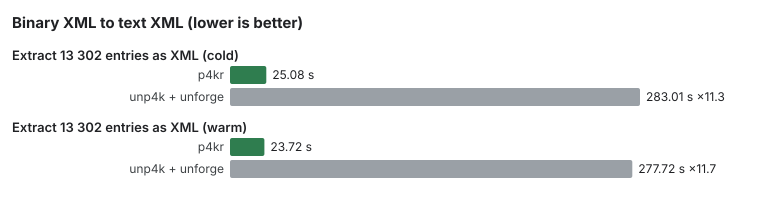
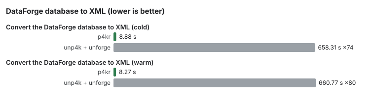

# Benchmarks

Wall-clock time, in seconds, lower is better. p4kr is compared with unp4k and StarBreaker (open and extract), and with unp4k followed by unforge (XML conversion).

## Setup

- Machine: 24 vCPU Intel Haswell, 92 GB RAM, Linux VPS.
- Archive: 156 330 315 776 bytes (about 156 GB), 1 379 308 entries, a release older than 4.10 (it contains no `PK\x03\x14` local headers, which first appear in 4.10 archives).
- Output goes to a separate folder on disk; "memory" mode (scenario O) only opens the archive.

## Method

- Passes are grouped in 3 alternating packets (p4kr, then the other tools), with several repetitions per packet and per tool. Open and extract: 15 passes per tool and cell. XML conversion: 15 passes per cell. DataForge: 15 passes for p4kr, 3 for the reference, which takes more than 10 minutes per pass.
- Each cell reports the median (min-max) of its passes.
- The ratio is the other tool's time divided by p4kr's time, with a bootstrap 95 % confidence interval. Where only a lower bound is given, the upper bound was not recorded.
- Cold: the OS page cache is dropped before each pass. Warm: second pass, cache filled.
- Scenarios: O opens the archive; E1 extracts 1 file; E2 extracts 1 folder (9 783 entries, 4.73 GiB); E3 extracts every file of 1 extension; X extracts a 13 302-entry subset with XML conversion; D converts the DataForge database to XML.

## Results

| Scenario | Tool | Cache | Median s (min-max) | Ratio vs p4kr [95 % CI] |
|---|---|---|---|---|
| Open the archive | p4kr | cold | 1.06 (0.98-1.20) | - |
| Open the archive | unp4k | cold | 7.62 (7.26-8.24) | ×7.1 [×6.9 ; ×7.5] |
| Open the archive | StarBreaker | cold | 7.11 (6.69-8.03) | ×6.7 [×6.5 ; ×6.9] |
| Open the archive | p4kr | warm | 0.55 (0.51-0.65) | - |
| Open the archive | unp4k | warm | 7.29 (6.95-7.88) | ×13.2 [×12.3 ; ×13.7] |
| Open the archive | StarBreaker | warm | 6.72 (5.98-7.57) | ×12.2 [×11.0 ; ×12.7] |
| Extract 1 file | p4kr | cold | 1.08 (1.02-1.12) | - |
| Extract 1 file | unp4k | cold | 9.28 (8.89-9.81) | ×8.6 [×8.3 ; ×8.8] |
| Extract 1 file | StarBreaker | cold | 7.01 (6.53-7.68) | ×6.5 [×6.3 ; ×6.7] |
| Extract 1 file | p4kr | warm | 0.63 (0.59-0.73) | - |
| Extract 1 file | unp4k | warm | 8.88 (8.39-10.17) | ×14.1 [×13.9 ; ×14.7] |
| Extract 1 file | StarBreaker | warm | 6.69 (6.31-7.29) | ×10.6 [×10.4 ; ×11.0] |
| Extract 1 folder | p4kr | cold | 4.41 (3.77-5.26) | - |
| Extract 1 folder | unp4k | cold | 37.89 (37.00-39.99) | ×8.6 [×7.9 ; ×9.3] |
| Extract 1 folder | StarBreaker | cold | 10.74 (9.93-11.26) | ×2.4 [×2.2 ; ×2.6] |
| Extract 1 folder | p4kr | warm | 1.89 (1.65-2.25) | - |
| Extract 1 folder | unp4k | warm | 21.92 (20.73-27.08) | ×11.6 [×10.6 ; ×13.5] |
| Extract 1 folder | StarBreaker | warm | 8.41 (7.96-9.53) | ×4.4 [×4.1 ; ×4.7] |
| Extract every file of 1 extension | p4kr | cold | 2.63 (2.53-3.40) | - |
| Extract every file of 1 extension | unp4k | cold | 24.00 (23.31-25.53) | ×9.1 [×8.4 ; ×9.3] |
| Extract every file of 1 extension | StarBreaker | cold | 8.45 (7.69-10.10) | ×3.2 [×2.9 ; ×3.4] |
| Extract every file of 1 extension | p4kr | warm | 1.68 (1.55-2.66) | - |
| Extract every file of 1 extension | unp4k | warm | 17.34 (16.28-18.45) | ×10.3 [×9.9 ; ×10.9] |
| Extract every file of 1 extension | StarBreaker | warm | 7.45 (6.89-7.84) | ×4.4 [×4.2 ; ×4.7] |
| Extract 13 302 entries as XML | p4kr | cold | 25.08 (24.11-27.28) | - |
| Extract 13 302 entries as XML | unp4k + unforge | cold | 283.01 (280.11-377.61) | ×11.3 (lower bound ×11.1) |
| Extract 13 302 entries as XML | p4kr | warm | 23.72 (22.09-25.14) | - |
| Extract 13 302 entries as XML | unp4k + unforge | warm | 277.72 (272.74-290.29) | ×11.7 (lower bound ×11.2) |
| Convert the DataForge database to XML | p4kr | cold | 8.88 (8.43-10.45) | - |
| Convert the DataForge database to XML | unp4k + unforge | cold | 658.31 (653.26-671.39) | ×74 (lower bound ×71) |
| Convert the DataForge database to XML | p4kr | warm | 8.27 (7.88-10.37) | - |
| Convert the DataForge database to XML | unp4k + unforge | warm | 660.77 (659.91-681.55) | ×80 (lower bound ×77) |

The warm ratio of scenario D is ≈ ×80 (660.77 / 8.27), lower bound ≥ ×77 from the warm gain CI.

## Correctness

- All 1 379 308 entries, and their XML, are byte-identical to the output of unp4k followed by unforge (25 155 shared errors produce no output on either side).
- The 62 620 DataForge records are byte-identical to unforge's.
- The Windows build of unforge writes CRLF line endings; p4kr writes LF.

## Limits

- One machine, one archive.
- The benchmark harness is private; the figures are published as measured.

## What changed in 1.0

The CLI prints its summaries in English. Scripts that parsed the former French text need to be adapted.
